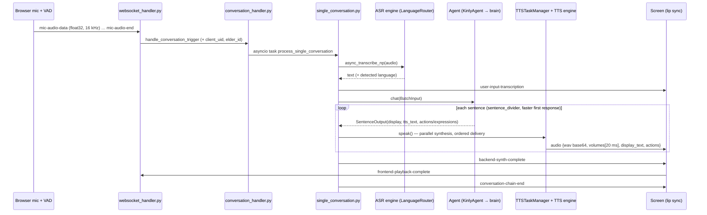

# How one voice turn flows (Open-LLM-VTuber, as used by Kinly)

**Key points in the base code**

- `ServiceContext` holds the engines (ASR, TTS, VAD, agent, Live2D). Each connection gets a copy that shares the default engines.
- `TTSTaskManager` synthesises sentences in parallel but sends them strictly in order (sequence numbers). This keeps time-to-first-audio low.
- `prepare_audio_payload` computes the RMS volume per 20 ms slice. The frontend maps it to mouth openness (lip sync).
- Interruption: the client sends `interrupt-signal` with the text heard so far. The conversation task is cancelled, and the agent is told what was actually heard.
- Expressions: the agent's sentence pipeline (`actions_extractor`) turns `[emotion]` keywords into Live2D expression indices.

**Where Kinly hooks in:** `kinly-hello` pairs a screen with an elder (`hub.py`). `KinlyAgent` replaces the chat agent while reusing the base sentence divider. `kinly_router_asr`/`kinly_router_tts` are ordinary factory engines. `turn_context` stamps time-to-first-audio when `TTSTaskManager` sends the first audio payload.
