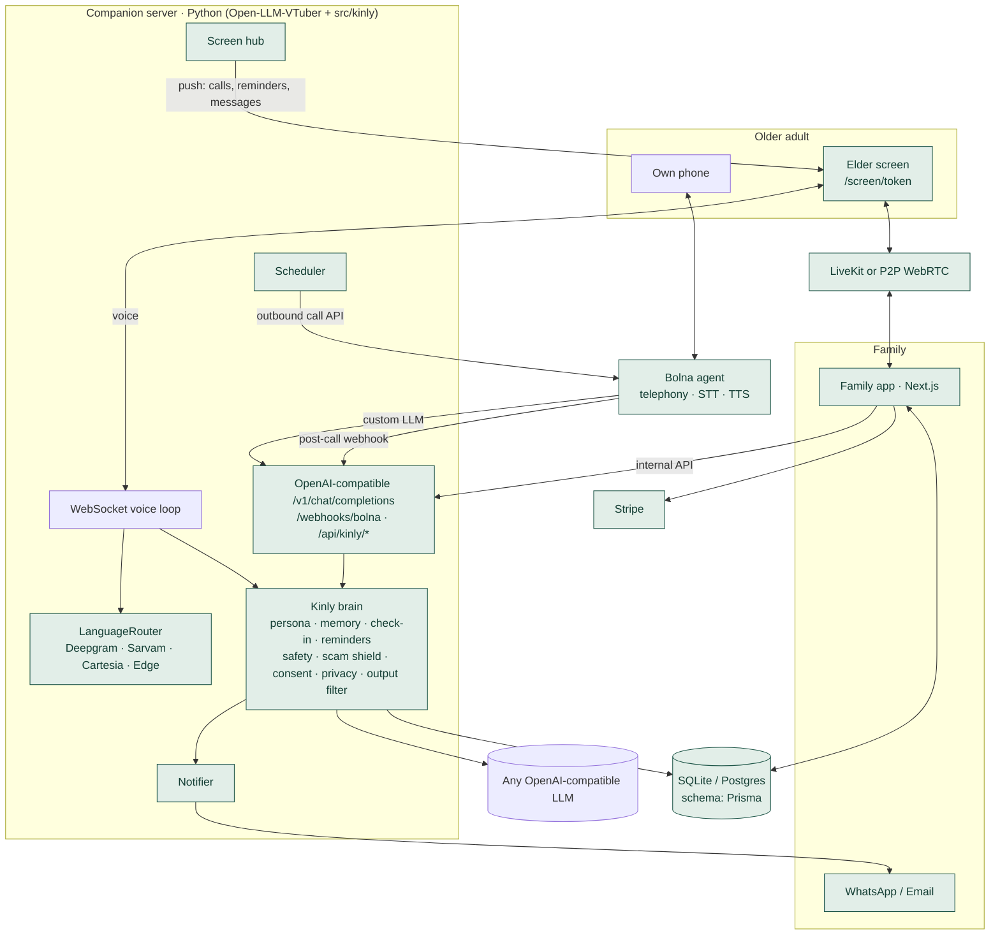

# Kinly architecture

## Design decisions

- **One brain, two transports.** The screen (WebSocket) and the phone (Bolna) both call `brain.respond()`. Memory, safety, consent and summaries behave identically.
- **Safety never depends on the LLM.** Urgent, scam and consent responses are fixed templates triggered by deterministic multilingual rules. The LLM handles conversation only, and a hard output filter checks every sentence it produces.
- **Identifying the elder on the phone.** Bolna sends only a Bearer token to custom LLMs. The agent prompt therefore includes `KINLY_CONTEXT elder_id={elder_id} caller={from_number} …`, which Bolna fills in per call. Outbound calls pass `elder_id` in `user_data`, and inbound calls are matched by caller number.
- **Shared database, one schema owner.** Prisma owns the schema. `src/kinly/schema.sql` is generated from it (`npm run db:sync`). Both sides store DateTime as epoch milliseconds (verified).
- **Demo reliability.** Every external dependency has a fallback: offline brain, Edge TTS, browser speech recognition, P2P video, plan activation without checkout, and a dashboard outbox for notifications. VAD assets are served locally, with no CDN.
- **Video provider.** LiveKit was chosen because it's the fastest reliable option with keys: hosted TURN, a prebuilt React UI, and a 10-line token server. Jitsi's public instance now requires moderator login, which breaks the one-tap elder flow. Without keys, a 1:1 WebRTC fallback signals through the family app.
